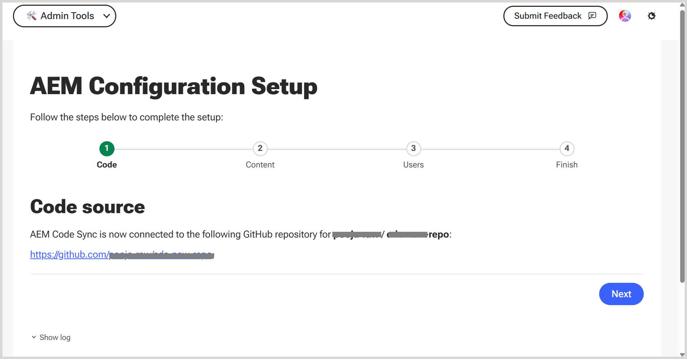
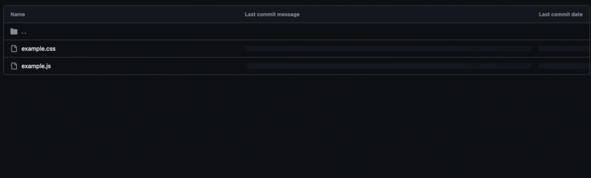

# Experience Manager Guides und Edge Delivery Services

Mit Adobe Experience Manager Guides können Sie Ihre DITA-Inhalte über ein dediziertes GitHub-basiertes Veröffentlichungsprofil direkt in Edge Delivery Services (EDS) veröffentlichen. Mit dieser Funktion können Unternehmen hochleistungsfähige, responsive Dokumentationserlebnisse bereitstellen und gleichzeitig DITA-basierte Authoring-Workflows in Experience Manager Guides beibehalten.

Weitere Informationen zur Verwendung von EDS in Adobe Experience Manager finden Sie in der [Übersicht über Edge Delivery Services](https://experienceleague.adobe.com/de/docs/experience-manager-cloud-service/content/edge-delivery/overview).

Um die Veröffentlichung von Experience Manager Guides in EDS zu aktivieren, müssen Sie eine Reihe von Konfigurationsschritten für GitHub und Experience Manager Guides durchführen. In den folgenden Abschnitten werden die einzelnen Schritte der Reihe nach beschrieben und erläutert, wie sie im gesamten Veröffentlichungs-Workflow zusammenarbeiten.

1. [Einrichten und Konfigurieren von GitHub für EDS](#set-up-and-configure-github-for-eds)
2. [Erstellen und Konfigurieren eines Veröffentlichungsprofils für EDS in Experience Manager Guides](#create-and-configure-a-publish-profile-for-eds-in-experience-manager)
3. [Anpassen der Ausgabe mithilfe von EDS-Blöcken](#customize-output-using-eds-blocks)

Eine kurze Videoanleitung finden Sie unter [Veröffentlichen in AEM Guides](https://experienceleague.adobe.com/de/docs/experience-manager-guides/using/knowledge-base/expert-session/publishing-in-aem-guides-aug25).


## Einrichten und Konfigurieren von GitHub für EDS

In diesem Abschnitt wird beschrieben, wie Sie GitHub für die Verwendung mit EDS einrichten und konfigurieren. Es behandelt das Erstellen eines Repositorys mit dem Adobe-Textbaustein, das Verbinden von GitHub mit Adobe Experience Manager über AEM Code Sync, das Konfigurieren der erforderlichen GitHub- und OAuth-Anwendungen und das Definieren des Repository-Bereitstellungspunkts, der für die Veröffentlichung von Inhalten verwendet wird.

### Erstellen eines GitHub-Repositorys für EDS

EDS erfordert ein GitHub-Repository mit einer vordefinierten Struktur. Adobe bietet ein offizielles Textbaustein-Repository, das speziell für Experience Manager Guides-Anwender entwickelt wurde.

Führen Sie die folgenden Schritte aus, um Ihr Repository zu erstellen:

1. Öffnen Sie das Experience Manager Guides-Vorlagenrepository [aem-guides-boilerplate](https://github.com/adobe/aem-guides-boilerplate).
   

2. Erstellen Sie mithilfe dieser Vorlage ein neues Repository. Erfahren Sie [Erstellen eines Repositorys aus einer Vorlage](https://docs.github.com/en/repositories/creating-and-managing-repositories/creating-a-repository-from-a-template). Stellen Sie sicher, dass die Repository-Sichtbarkeit auf &quot;*&quot;* ist, damit der Zugriff über EDS möglich ist.

   

Das Repository wird jetzt erstellt und an der Textbausteinvorlagenstruktur ausgerichtet.


### Erstellen einer neuen OAuth-App

Zum Authentifizieren von Benutzern beim Erstellen eines EDS-Veröffentlichungsprofils in Experience Manager Guides ist eine OAuth-App erforderlich. Dies ermöglicht einen sicheren Anmeldefluss mit einer *Client-ID* und *Client-Geheimnis*.

Führen Sie die folgenden Schritte aus, um eine neue OAuth-App zu erstellen:

1. Navigieren Sie auf GitHub zur linken Seitenleiste und wählen Sie **Entwicklereinstellungen**.
2. Wählen Sie in der linken Seitenleiste **OAuth-Apps** aus.
3. Wählen Sie **Neue OAuth-App** aus.

   {width="650"}

4. Registrieren Sie Ihre Anwendung, indem Sie die folgenden obligatorischen Details angeben:

   - **Anwendungsname**: Geben Sie den Namen Ihres EDS-Repositorys ein
   - **Homepage-URL**: Geben Sie die URL für die Experience Manager Guides-Instanz ein. (Das Beispiel-URL-Format finden Sie in Schritt 4 des Abschnitts [Erstellen einer neuen GitHub](#create-a-new-github-app)App).
   - **Autorisierungs-Callback-URL**: identisch mit der Homepage-URL

5. Wählen Sie die Option **Gerätefluss aktivieren** und wählen Sie dann **Anwendung registrieren**, um die Registrierung abzuschließen.

   {width="650"}

Ihre App ist jetzt bereit. Notieren Sie sich die *Client-ID*. Beim Konfigurieren des Veröffentlichungsprofils in *können Sie jetzt oder* bis zu fünf Client-Geheimnisse generieren.


### Konfigurieren der Bereitstellungspunkt-URL im EDS-Repository

EDS liest Inhalte aus einer *Bereitstellungspunkt*-URL, die in der `fstab.yaml`-Datei im Stammverzeichnis Ihres Repositorys definiert ist. Diese URL verweist EDS auf den Speicherort, an dem Experience Manager Guides die generierten Inhalte veröffentlicht.

So konfigurieren Sie die Bereitstellungspunkt-URL in der `fstab.yaml`:

1. Öffnen Sie die `fstab.yaml`-Datei in Ihrem GitHub-Repository.
2. Aktualisieren Sie den `url` unter Verwendung des folgenden Formats:

   ```text
   https://guides.adobe.com/eds-workers/<account type>/<git acc domain>/<git username>/<git repo>/<branch>/<root folder>
   ```

   In der folgenden Tabelle werden die einzelnen Felder der URL beschrieben:

   | Feld | Beschreibung |
   |---|---|
   | `https://guides.adobe.com/eds-workers` | Worker-URL, die von Experience Manager Guides zum Veröffentlichen von Inhalten in EDS verwendet wird. Ändern Sie diesen Wert nicht. |
   | `<account type>` | Typ des Git-Kontos. Auf `github` setzen. |
   | `<git acc domain>` | Domain Ihres Git-Kontos. Auf `github.com` setzen. |
   | `<git username>` | Ihr GitHub-Benutzername. |
   | `<git repo>` | Name des GitHub-Repositorys, das Sie für EDS erstellt haben |
   | `<branch>` | Verzweigung, auf der der Inhalt veröffentlicht werden soll. Der Standardwert ist `main`. Wenn Sie den Verzweigungsnamen auf GitHub ändern, aktualisieren Sie ihn hier und im EDS-Veröffentlichungsprofil in Experience Manager Guides. |
   | `<root folder>` | Stammordner des Repositorys, in den die veröffentlichten Dateien übertragen werden. Der Standardwert ist `docs`. Wenn Sie den Ordnernamen auf GitHub ändern, aktualisieren Sie ihn hier und im EDS-Veröffentlichungsprofil in Experience Manager Guides. |

   Wenn beispielsweise Ihr GitHub-Benutzername `my-username` und Ihr Repository-Name `my-eds-repo` ist, wird die `fstab.yaml` wie folgt angezeigt:

   ```yaml
   mountpoints:
     /:
       url: https://guides.adobe.com/eds-workers/github/github.com/my-username/my-eds-repo/main/docs
       type: markup
   ```

   {width="650"}

   >[!NOTE]
   >
   > Wenn Sie weiterhin das frühere URL-Format (`https://guides.adobe.com/eds-workers/<git username>/<git repo>/<branch>/<root folder>`) verwenden, werden für den Kontotyp und die Domain standardmäßig `github` und `github.com`.

3. Wiederholen Sie die Schritte 2 und 3 aus dem Abschnitt [Verbinden von GitHub mit Adobe über AEM Code-](#connect-github-to-adobe-via-aem-code-sync)), um das Repository zu autorisieren.

### Verbinden von GitHub mit Adobe über die AEM-Codesynchronisierung

Adobe Experience Manager verwendet eine GitHub-Anwendung namens **AEM Code Sync**, um Inhalte von Experience Manager Guides auf GitHub zu pushen.

Führen Sie die folgenden Schritte aus, um die Anwendung *AEM Code Sync* zu installieren und zu konfigurieren:

1. Navigieren Sie zur Seite [AEM Code Sync](https://github.com/apps/aem-code-sync) und wählen Sie **Installieren**.

   **AEM Code Sync** überwacht Repository-Änderungen und stellt sicher, dass Aktualisierungen korrekt an GitHub gesendet werden.

   >[!NOTE]
   >
   >Stellen Sie bei der Installation der Anwendung sicher, dass Sie dasselbe GitHub-Konto verwenden, dem das Repository gehört.

   

2. Gewähren Sie auf der nächsten Seite Zugriff auf das von Ihnen erstellte Repository. Wählen Sie **Nur Repositorys auswählen** und wählen Sie dann Ihr Repository aus der Dropdown-Liste aus.

   {width="350"}

3. Wählen Sie **Installieren und autorisieren** aus.

   Sie werden zur GitHub-Setup-Seite weitergeleitet.

   

4. Überprüfen Sie die Details zum Quell-Code und wählen Sie **Weiter** aus.

5. Konfigurieren Sie auf **Seite** Inhaltsquelle“ die folgenden Einstellungen:

   - **Quelltyp des Inhalts:** Wählen Sie **Sonstige (eigenes Markup einbringen)**.
   - **Inhaltsquellen-URL:** Überprüfen Sie die URL, die als Bereitstellungspunkt-URL in der `fstab.yaml`-Datei konfiguriert ist. Wenn Sie die URL in der Datei nicht aktualisiert haben, können Sie sie hier aktualisieren.
   - **Dateierweiterung:** Ändern Sie das standardmäßige `.html` Suffix in `.htm`.

   Stellen Sie sicher **dass „Andere Inhaltsquelle verwenden** ausgewählt ist.

6. Fügen Sie auf der **Benutzer** bei Bedarf Benutzer hinzu und klicken Sie dann auf **Weiter**.

7. Überprüfen Sie die Konfigurationsübersicht und wählen Sie **Speichern** aus.

   Nach erfolgreicher Registrierung wird eine Bestätigungsseite angezeigt. Sie können die URLs **Vorschau** und **Live** für Ihre Website von dieser Seite kopieren und speichern.

   

## Einrichten und Konfigurieren von GitLab für EDS

Anweisungen zum Konfigurieren von GitLab als Publishing-Repository für Edge Delivery Services finden Sie unter [Einrichten und Konfigurieren von GitLab für EDS](./configure-eds-gitlab.md).

## Erstellen und Konfigurieren eines Veröffentlichungsprofils für EDS in Experience Manager

In den folgenden Abschnitten werden die einzelnen Schritte nacheinander beschrieben und erläutert, wie Sie das EDS-Veröffentlichungsprofil einrichten, eine Ausgabevorgabe konfigurieren und mithilfe von EDS in Experience Manager Guides eine Ausgabe generieren.

### Erstellen des EDS-Veröffentlichungsprofils für GitHub oder GitLab

1. Wechseln Sie zu **[Workspace](/help/product-guide/cs-install-guide/workspace-settings.md)** Einstellungen **>** Profile **veröffentlichen**.
2. Wählen Sie das Symbol **+** aus, um ein neues Veröffentlichungsprofil zu erstellen, und geben Sie die folgenden Details an:

   - **Servertyp\*:** Wählen Sie **Git (Edge Delivery-Service)** aus der Dropdown-Liste aus.
   - **Name\*:** Geben Sie einen Namen für das Veröffentlichungsprofil ein.
   - **Git-Kontotyp\*:** Wählen Sie **GitHub** oder **GitLab** aus der Dropdown-Liste aus, je nach Git-Repository-Anbieter.
   - **Instanz-URL\*:** Geben Sie die URL Ihrer GitHub- oder GitLab-Instanz ein, z. B. `https://github.com` oder `https://gitlab.com`.
   - **Repository-Name\*:** Geben Sie den Namen Ihres GitHub- oder GitLab-Repositorys ein.
   - **Benutzername\*:** Geben Sie Ihren GitHub- oder GitLab-Benutzernamen ein.
   - **Zweigname:** auf `main` (Standard) gesetzt.
   - **Stammordner\*:** Auf `docs` (Standard) gesetzt.
   - **Site-Inhaber (*nur GitLab*):** Geben Sie den Inhaber der Edge Delivery Services-Site ein.
   - **Site-Repository (nur *-Lab*:** Geben Sie den Repository-Namen ein, der mit der Edge Delivery Services-Site verknüpft ist.
   - **HLX-API-Schlüssel** Geben Sie den HLX-API-Schlüssel für Ihre EDS-Konfiguration ein. Dieser Schlüssel ist erforderlich, um die Funktion „Veröffentlichung rückgängig gemacht“ zu unterstützen, die in der Version 2026.11.0 von Experience Manager Guides as a Cloud Service eingeführt wurde. Außerdem ist der Schlüssel für die Veröffentlichung des Inhalts in EDS erforderlich, wenn die Inhaltsgröße mehr als 100 Dateien beträgt.
   - **Authentifizierungsberechtigungen:** Geben Sie die Anmeldeinformationen basierend auf dem ausgewählten Git-Kontotyp an:
     - **GitHub:** Geben Sie die **Client-ID\*** und **Client-Geheimnis\*** ein, die Sie von Ihrer GitHub OAuth-App erhalten haben. Weitere Informationen finden [&#x200B; unter „Erstellen einer neuen OAuth-](#create-a-new-oauth-app)&quot;.
     - **GitLab:** Geben Sie das **Zugriffstoken\*** ein, das für Ihr GitLab-Konto generiert wurde.
3. (*Nur GitHub*) Wählen Sie **Anmelden** aus, um sich zu authentifizieren. Für GitLab ist keine Anmeldung erforderlich, da das Zugriffstoken für die Authentifizierung verwendet wird.

   {width="650"}

4. Klicken Sie auf **Speichern**. Für GitHub ist die Option **Speichern** nach erfolgreicher Authentifizierung verfügbar.

Ihr EDS-Veröffentlichungsprofil ist jetzt konfiguriert.

### Erstellen einer Ausgabevorgabe für EDS und Generieren einer Ausgabe

1. Öffnen Sie Ihre Karte in der Kartenkonsole.
2. Wählen Sie auf **Registerkarte** Ausgabevorgaben“ **+** aus, um eine neue Ausgabevorgabe zu erstellen.
3. Geben Sie **Dialogfeld „Neue**&quot; die folgenden Details ein:
   - **type**: **Edge Delivery-Service auswählen**
   - **Name**: Geben Sie einen Namen für diese Voreinstellung an
4. Wählen Sie **Hinzufügen** aus.

   {width="650"}
5. Öffnen Sie die neu erstellte EDS-Ausgabevorgabe und konfigurieren Sie die folgenden Felder:

   - **Bedingte Filterung:** Wählen Sie **Keine**, um eine Ausgabe ohne Filterung zu generieren, oder **Mit DITAVAL**, um die bedingte Filterung anzuwenden.
   - **Unterordner veröffentlichen:** Geben Sie den Namen des Unterordners ein, in dem die Ausgabe veröffentlicht wird. Der Unterordner wird im Repository unter dem Stammordner erstellt und erscheint in den EDS-Links zum veröffentlichten Inhalt. Wenn beispielsweise der Stammordner `docs` und der Unterordner Veröffentlichen `product-guide` ist, wird der Inhalt in `docs/contents/product-guide` veröffentlicht.
   - **Veröffentlichungsprofil:** Sie das im vorherigen Abschnitt konfigurierte GitHub- oder GitLab-Veröffentlichungsprofil aus.

     {width="650"}

6. Wählen Sie **Speichern** und dann **Ausgabe generieren**.

>[!NOTE]
>
>Die generierte Ausgabe wird im Ordner `<root folder>/contents/<publish subfolder>` des EDS-Repositorys gespeichert.

Die EDS-Ausgabe wird jetzt generiert. Der Inhalt wird in einem sauberen, responsiven Layout präsentiert. Sie enthält reguläre Elemente wie den Seitentitel, Breadcrumbs, Textinhalte und alle im Thema verwendeten Blöcke. Das Inhaltsverzeichnis auf der linken Seite (generiert aus der Karte) hilft Ihnen, durch Themen zu navigieren, während ein Mini-Inhaltsverzeichnis auf der rechten Seite die Abschnitte innerhalb der aktuellen Seite hervorhebt. Die gesamte Ausgabe ist vollständig responsiv und sorgt für ein optimiertes, konsistentes Leseerlebnis auf allen Geräten.

>[!NOTE]
>
> Sie können mehrere DITA-Karten auf derselben Website veröffentlichen. Die veröffentlichten Karten werden im linken Navigationsbereich angezeigt, sodass Benutzer von jeder Karte aus auf die Inhalte zugreifen können. Beim Veröffentlichen einer neuen Zuordnung werden die zuvor veröffentlichten Zuordnungen nicht überschrieben.


## Anpassen der Ausgabe mithilfe von EDS-Blöcken

EDS verwendet `blocks`, um zu steuern, wie verschiedene Teile Ihres Inhalts formatiert und angezeigt werden. Sie können vorhandene Blöcke ändern oder benutzerdefinierte Blöcke erstellen.

Die folgenden Beispiele führen Sie durch die Anpassung eines vorhandenen Bausteins und die Erstellung eines neuen Bausteins, um die endgültige EDS-Ausgabe in Experience Manager Guides zu gestalten.

### Anpassen eines Breadcrumb-Blocks, um seine Textfarbe zu aktualisieren

Breadcrumbs werden seitenübergreifend verwendet, damit Benutzer verstehen können, wo sie sich in der Dokumentation befinden. Da dieser Baustein auf der gesamten Website konsistent angezeigt wird, ermöglicht eine Aktualisierung seines Stils eine einheitliche Design-Aktualisierung.

Führen Sie die folgenden Schritte aus, um einen Breadcrumb-Block anzupassen und seine Textfarbe zu aktualisieren:

1. Wechseln Sie zu Ihrem GitHub-Repository und öffnen Sie den Ordner `blocks` .
2. Wählen Sie den **Breadcrumbs**-Block aus.

   {width="650"}
3. Öffnen Sie die `css` und aktualisieren Sie die Textfarbe.
4. Übertragen Sie die Änderungen an GitHub.
5. Aktualisieren Sie die Live-Website, um die Aktualisierungen anzuzeigen.

### Aktualisieren von EDS-Skripten zum Erstellen benutzerdefinierter Elemente in der veröffentlichten Ausgabe

In einigen Fällen möchten Sie möglicherweise nur einen bestimmten Teil Ihres Inhalts formatieren. Führen Sie die folgenden Schritte aus, um dies mithilfe eines benutzerdefinierten Blocks zu erreichen.

1. Öffnen Sie die Themendatei und wählen Sie den Text in einem Tag-Element aus.

   Im folgenden Screenshot ist der Inhalt innerhalb des `example`-Tags ausgewählt.
   {width="650"}
2. So konfigurieren Sie den Text im `example`-Tag:
   - Navigieren Sie zu **Inhaltseigenschaften**.
   - Fügen Sie das Attribut `outputclass` hinzu.
   - Legen Sie den Wert auf `example eds-force-block` fest.
   - Wählen Sie **Hinzufügen** aus.
     {width="650"}
3. Speichern und regenerieren Sie die Ausgabe.
4. Erstellen Sie einen neuen Ordner mit demselben Namen wie der `outputclass` im `blocks`. Erfahren Sie mehr über [Hinzufügen von Dateien zu einem Repository](https://docs.github.com/en/repositories/working-with-files/managing-files/adding-a-file-to-a-repository#adding-a-file-to-a-repository-using-the-command-line).

   {width="650"}

5. Fügen Sie die erforderlichen `css` und optionale `js` hinzu.

   {width="650"}

6. Änderungen übernehmen und Ausgabe neu generieren.

Der ausgewählte Inhalt zeigt jetzt die benutzerdefinierten Stile an, die in Ihrem Block definiert sind.

{width="650"}
