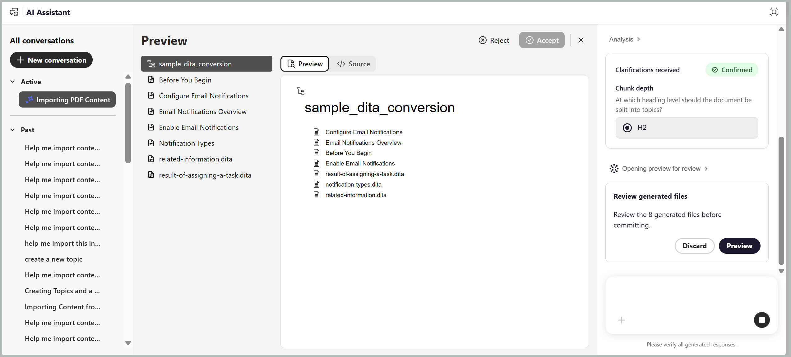

# Neue Funktionen in der Version 2026.11.0 (November 2026)

Dieser Artikel behandelt die neuen und erweiterten Funktionen, die mit der Version 2026.11.0 von Adobe Experience Manager Guides as a Cloud Service eingeführt wurden.

Eine Liste der in dieser Version behobenen Probleme finden Sie unter [Behobene Probleme in Version 2026.11.0](fixed-issues-2026-11-0.md).

Erfahren Sie mehr [Upgrade-Anweisungen für die Version 2026.11.0](../release-info/upgrade-instructions-2026-11-0.md).

## Einführung von Verzweigungen auf Zuordnungsebene und Zusammenführungen

Experience Manager Guides führt Verzweigungs- und Zusammenführungsfunktionen auf Zuordnungsebene ein, mit denen Autoren parallel an mehreren Dokumentationsversionen, Funktionsaktualisierungen und wichtigen Korrekturen arbeiten können, ohne den Hauptinhalt zu beeinträchtigen. Autoren können isolierte Verzweigungen einer DITA-Zuordnung und ihrer Abhängigkeiten erstellen, um sicherzustellen, dass Bearbeitungen, Sperren und Vorschauen für jede Verzweigung spezifisch bleiben.

Mit dieser Funktion können Dokumentations-Teams parallele Arbeitsabläufe verwalten, effizient zusammenarbeiten und die Stabilität der Hauptdokumentationsversion aufrechterhalten. Sie haben folgende Möglichkeiten:

- **Erstellen Sie Verzweigungen** von der Hauptversion einer DITA-Zuordnung, um Funktionen, Verbesserungen oder kritische Fehlerbehebungen unabhängig voneinander zu bearbeiten.
- **Wechseln zwischen Verzweigungen** im Editor, um mehrere Dokumentationsversionen zu verwalten.
- **Verwalten von Inhaltsversionen**, um Änderungen durch Verzweigung und Zusammenführung zu organisieren.
- **Beheben von Zusammenführungskonflikten** mithilfe eines geführten Vergleichs-Workflows mit dreiseitiger Zusammenführung.
- **Änderungen zusammenführen** mit der Hauptversion.
- **Veröffentlichen Sie direkt aus einer Verzweigung** verwenden Sie die Standardveröffentlichung, ohne die Hauptversion zu ändern.

Weitere Informationen zu [Verzweigung und Zusammenführung](../user-guide/branching-overview.md).

{width="650"}

## KI-gestützte Inhaltserstellung und Importfähigkeiten im KI-Assistenten

>[!NOTE]
>
>Um den KI-Assistenten im Agentenmodus verwenden zu können, muss Ihr Unternehmen in Adobe CX Enterprise Coworker integriert sein und über die erforderlichen Credits verfügen.

Sie können jetzt **KI-**) verwenden, um DITA-Inhalte mithilfe von Eingabeaufforderungen in natürlicher Sprache zu erstellen und zu importieren. Die auf **Adobe CX Enterprise Coworker** basierenden neuen **Erstellen** und **Importieren** vereinfachen die Erstellung strukturierter Inhalte und helfen Autoren bei der Arbeit mit DITA-Inhalten, ohne dass sie umfangreiches DITA-Know-how benötigen.

- **Erstellen** Generieren von DITA-Themen und -Karten aus Eingabeaufforderungen in natürlicher Sprache, Referenzdokumenten oder vorhandenem Inhalt mithilfe von Repository-Vorlagen. Sie können den generierten Inhalt vor dem Speichern überprüfen und neue oder vorhandene Inhalte iterativ verfeinern, um Ihre Anforderungen zu erfüllen.
- **Importieren** Konvertieren Sie vorhandene PDF-, DOCX- oder Markdown-Dateien in strukturierte DITA-Themen und -Zuordnungen. Sie können den konvertierten Inhalt überprüfen, bevor Sie ihn im Repository speichern.
- **Smart-Tagging** Erhalten Sie relevante Tag-Empfehlungen für Ihre Inhalte, die auf der Taxonomie Ihres Unternehmens basieren. Das erweiterte Erlebnis ermöglicht es Admins, Taxonomie-Namespaces in den Workspace-Einstellungen zu konfigurieren, um konsistente und verwaltete Tag-Empfehlungen sicherzustellen.

Das Bedienfeld **KI** Assistent) bietet zudem einen Vollbildmodus und einen Abschnitt **Aktive**&quot; für ein verbessertes Gesprächserlebnis.

Weitere Informationen finden Sie unter [Verwenden des KI-Assistenten im Agentenmodus](../user-guide/ai-assistant.md#agentic-mode).

{width="650"}

## Neues Hilfeassistenten-Bedienfeld in Experience Manager Guides

Die generative KI-gestützte **Smart-Hilfe**-Funktion ist über das dedizierte Bedienfeld **Hilfeassistent** verfügbar, auf das über die Konsolenoberflächen „Startseite“, „Editor“ und „Zuordnung“ zugegriffen werden kann. Das Bedienfeld bietet ein dialogorientiertes Sucherlebnis, mit dem Sie Fragen in natürlicher Sprache stellen und schnell relevante Informationen aus der Experience Manager Guides-Dokumentation finden können. Auf diese Weise können Sie auf kontextuelle Anleitungen zugreifen und Abfragen auflösen, ohne den Editor zu verlassen, was Ihren Authoring-Workflow optimiert.

Administratoren können die Verfügbarkeit des Hilfeassistenten-Bedienfelds über die Workspace-Einstellungen verwalten. Der Abschnitt **KI-**) enthält einen Umschalter zum Aktivieren oder Deaktivieren des Bedienfelds für Benutzer.

Weitere Informationen finden Sie unter [Hilfe-Assistent](../user-guide/ai-based-smart-help.md).

{width="650"}

## Verbesserungen bei der Inhaltserstellung

### Nachverfolgen von Änderungen im Bedienfeld „Neuer Editor“

Das Bedienfeld **Änderungen verfolgen** ist jetzt im neuen Editor verfügbar, sodass Sie alle verfolgten Einfügungen und Löschungen innerhalb eines Themas anzeigen können. Sie können Änderungen verfolgen, die von mehreren Benutzern vorgenommen wurden, und Änderungen direkt über das Bedienfeld annehmen oder ablehnen.

Sie können auch steuern, wie gelöschte Inhalte im Editor angezeigt werden, indem Sie die Einstellung **Nachverfolgte Löschungen inline anzeigen** verwenden, mit der Sie gelöschte Inhalte als durchgestrichenen Text anzeigen oder durch ein mit der entsprechenden Änderung verknüpftes Stiftsymbol ersetzen können. Weitere Informationen zu [Änderungen verfolgen](../user-guide/config-editor-settings.md#track-changes).

{width="650"}

### Sortieren von Dateien und Ordnern im Explorer-Bedienfeld

Das **Explorer**-Bedienfeld im Editor ermöglicht die Sortierung von Dateien und Ordnern in auf- oder absteigender Reihenfolge mithilfe der Schaltfläche **Sortieren**. Standardmäßig werden die Elemente in aufsteigender Reihenfolge nach Titel oder Dateinamen sortiert, basierend auf der Einstellung **Editor-Dateien** in **Benutzereinstellungen**. Dies erleichtert die Navigation und das Auffinden von Inhalten im Editor.

Weitere Informationen finden Sie im [Explorer](../user-guide/paginated-loading-assets.md#explorer) unter Paginiertes Laden von Dateien und Ordnern.

### Verwalten von Versionen und Beschriftungen für Nicht-DITA-Dateien über den Editor

Mit Experience Manager Guides können Sie den Versionsverlauf anzeigen und Versionsbeschriftungen für Nicht-DITA-Dateien wie Bilder, Multimedia-, ZIP-, PDF- und DOCX-Dateien direkt im Editor verwalten. Sie können eine Vorschau dieser Dateien anzeigen, ihren Versionsverlauf überprüfen, Versionen vergleichen und zu einer früheren Version zurückkehren, ohne zur Assets-Benutzeroberfläche navigieren zu müssen. Sie können auch Versionsbezeichnungen für vorhandene Dateiversionen anwenden oder aktualisieren, um die Versionserkennung und -verwaltung zu vereinfachen.

Weitere Informationen finden Sie unter [Arbeiten mit Medien und anderen Nicht-DITA-Dateien](../user-guide/authoring-file-management.md#work-with-media-and-other-non-dita-files).

{width="650"}

## Verbesserungen bei Überprüfungen

### Verbesserte Zusammenarbeit bei der Überprüfung mit Initiatorkommentaren

Überprüfungsinitiatoren können über die Überprüfungs-Benutzeroberfläche Inline-Kommentare und Anmerkungen zu Themen innerhalb einer Überprüfungsaufgabe hinzufügen. Auf diese Weise können sie zusätzlichen Kontext bereitstellen, bestimmte Inhalte hervorheben und die Aufmerksamkeit der Prüfer auf Bereiche lenken, die Feedback erfordern.

Diese Kommentare werden im Bedienfeld **Kommentare** zusammen mit dem Feedback anderer Prüfer angezeigt und bieten einen konsolidierten Überblick über die Überprüfungsdiskussionen. Reviewer erhalten auch eine AEM-Benachrichtigung, wenn der Initiator einen Kommentar hinzufügt, der die Zusammenarbeit und Kommunikation während des gesamten Überprüfungsprozesses optimiert. Weitere Informationen finden Sie unter [Kommentare für Reviewer hinzufügen](../user-guide/review-send-topics-for-review.md#add-comments-for-reviewers).

## Verbesserungen beim Veröffentlichen

### Anzeigen und Verwalten des Ausgabehistoriums über die Map-Konsole

Die Zuordnungskonsole in Experience Manager Guides enthält jetzt die Registerkarte **Ausgabehistorie**, auf der Sie Ausgabegenerierungsaufgaben direkt im Editor anzeigen und verwalten können, ohne zum Zuordnungs-Dashboard zu navigieren.

Die Registerkarte bietet eine konsolidierte Ansicht der Aufgaben zur Ausgabegenerierung, einschließlich ihres Status, der Voreinstellungsdetails, des Generierungsdatums und der Dauer. Sie können Aufgaben suchen und filtern, laufende Generierungen abbrechen, auf generierte Ausgaben und Protokolle zugreifen und abgeschlossene Einträge aus dem Verlauf entfernen. Sie können den Ausgabehistorie auch als CSV-Datei zur weiteren Analyse exportieren. Ausgabegenerierungsstatus verwenden Farbindikatoren, die mit dem Zuordnungs -Dashboard konsistent sind.

Weitere Informationen finden Sie unter [Prozess zur Ausgabenerstellung verwalten](../user-guide/generate-output-manage-process.md#view-and-manage-output-generation-tasks-from-the-editor).

{width="650"}

### Verbesserte Optionen zum Löschen des Ausgabedatensatzverlaufs

Sie können den Ausgabehistorie-**(nach Alter** (Entfernen von Einträgen, die älter als eine bestimmte Anzahl von Tagen sind) oder **Nach Anzahl** (Beibehalten einer bestimmten Anzahl aktueller Einträge) bereinigen.

Sie können auch festlegen, dass nur die Ausgabeprotokolle bereinigt werden sollen, während die Verlaufseinträge für Überwachungszwecke beibehalten werden, oder dass sowohl die Protokolle als auch die zugehörigen Einträge entfernt werden. Diese Optionen helfen bei der Optimierung des Repository-Speichers und bieten gleichzeitig eine bessere Kontrolle über die Bereinigung des Ausgabedatensatzverlaufs.

Weitere Informationen finden Sie unter [Konfigurieren des automatischen Bereinigungszeitraums für den Ausgabegeschichte](../install-conf-guide/conf-output-generation.md#configure-auto-purging-period-for-output-history-id19aai070v8q).

### GitLab-Unterstützung für Edge Delivery Services-Veröffentlichungsprofile

Die Edge Delivery Services-Veröffentlichung unterstützt neben GitHub auch von GitLab gehostete Repositorys und bietet so mehr Flexibilität bei der Verwaltung und Veröffentlichung von DITA-Inhalten. Um auf einer von GitLab gehosteten Site zu veröffentlichen, wählen Sie beim Erstellen eines Edge Delivery Services-Veröffentlichungsprofils GitLab als Server-Typ aus und geben Sie das Projekt-Zugriffstoken des Repositorys im Feld Zugriffstoken an.

Veröffentlichungsvorgaben enthalten auch ein Feld für einen Unterordner, sodass Sie Inhalte in einem Unterordner innerhalb des im Profil angegebenen Stammordners veröffentlichen können.

Weitere Informationen finden Sie unter [Konfigurieren einer Edge Delivery Services](../knowledge-base/publishing/configure-eds.md).

### Verbesserungen an der Salesforce-Veröffentlichung

Experience Manager Guides verbessert die Salesforce-Veröffentlichung durch verbesserte Sicherheit, Leistung und Veröffentlichungseffizienz. Zu diesen Verbesserungen gehören die Unterstützung für Proof Key for Code Exchange (PKCE), die Aktualisierung der Token-basierten Authentifizierung, der Veröffentlichungsstatus auf Artikelebene, detaillierte Veröffentlichungsprotokolle, der Ausgabehistorie und die optimierte Asset-Veröffentlichung, um redundante Uploads zu reduzieren.

Weitere Informationen finden Sie unter [Erweiterte Salesforce-Veröffentlichung mithilfe der Backend-Verarbeitung](../user-guide/web-editor-article-publishing.md#enhanced-salesforce-publishing-using-backend-processing).

### Unterstützung für Bilder aus Zuordnungsmetadaten im nativen PDF

Native PDF-Veröffentlichung unterstützt die dynamische Anzeige von Bildern, die in den Metadaten von DITA-Karten, Lesekarten und benutzerdefinierten Karten definiert sind. Sie können eine einzelne PDF-Vorlage für mehrere Zuordnungen verwenden und gleichzeitig zuordnungsspezifische Bilder, z. B. Produktabdeckungsbilder, in der generierten Ausgabe anzeigen.

Durch Hinzufügen eines Bild-Platzhalters zum Seiten-Layout können Sie es während der Veröffentlichung automatisch mit dem Bild füllen, auf das in den Zuordnungsmetadaten verwiesen wird. Dadurch entfällt die Notwendigkeit, separate Vorlagen für verschiedene Bilder zu verwalten, und die Vorlagenverwaltung wird vereinfacht.

Weitere Informationen finden Sie unter [Hinzufügen eines Bildes aus Zuordnungsmetadaten](../native-pdf/design-page-layout.md#add-an-image-from-map-metadata-add-image-map-metadata).

### Überprüfen der Inhaltsqualität mit einer Konsistenzprüfung des Inhalts im alten Editor

Die Konsistenzprüfung von Inhalten ist im alten Editor verfügbar (wird bereits im neuen Editor unterstützt) und hilft bei der Überprüfung der Inhaltsqualität in allen DITA-Zuordnungen vor der Veröffentlichung. Admins können wiederverwendbare Konsistenzprüfungs-Voreinstellungen erstellen, indem sie Prüfungen auf fehlerhafte Links, doppelte IDs und die Schematron-Validierung kombinieren.

Autoren können im alten Editor eine Konsistenzprüfung für eine DITA-Zuordnung oder eine ausgewählte Grundlinie ausführen, um einen konsolidierten Bericht zu Problemen in allen zugehörigen Themen und Zuordnungen zu generieren. Weitere Informationen finden Sie unter [Ausführen einer Konsistenzprüfung auf einer Karte](../user-guide/map-editor-other-features.md#run-health-check-on-a-map).

## Upsert-API für die Migration veralteter Inhalte

Mit dieser API können Sie Inhalte und zugehörige Metadaten über eine einzige API erstellen oder aktualisieren. Es unterstützt die Angabe von Themeninhalten, Metadaten und einer GUID in der Anfrage. Die API ist in der Dokumentation zur Swagger-API unter `/bin/guides/v1/asset/upsert/` verfügbar.