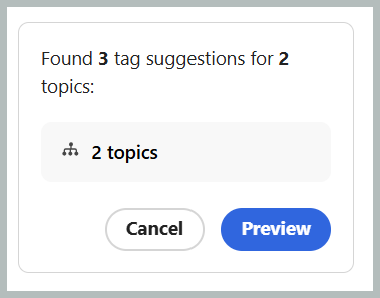
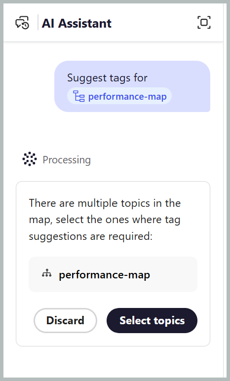

# Smart-Tagging mit dem KI-Assistenten

Die Smart-Tagging-Fähigkeit, die im Agenten-Modus des KI-Assistenten über Adobe CX Enterprise Coworker verfügbar ist, macht das Tagging Ihrer Inhalte schneller, einfacher und konsistenter. Es analysiert Ihren Inhalt und empfiehlt relevante Tags basierend auf der Taxonomie Ihres Unternehmens, sodass Sie Inhalte nicht manuell überprüfen und die entsprechenden Tags identifizieren müssen. Ihr Administrator kann die Taxonomien konfigurieren, die zum Generieren von Tag-Empfehlungen über [Workspace-Einstellungen verwendet werden](../install-conf-guide/workspace-settings.md#general) indem er die entsprechenden Namespaces für Ihren Arbeitsbereich auswählt.

Sie behalten die Kontrolle, indem Sie die vorgeschlagenen Tags überprüfen und sie anwenden oder ablehnen, bevor Sie Ihre Auswahl bestätigen. Dies reduziert den manuellen Aufwand, verbessert die Tagging-Genauigkeit und hilft bei der Beibehaltung konsistenter Metadaten in Ihrer gesamten Dokumentation.

## Anwenden von Tags auf einzelne oder mehrere Themen mit der Fähigkeit zum Smart-Tagging

Führen Sie die folgenden Schritte aus, um den KI-Assistenten zum Anwenden von Tags auf einzelne oder mehrere Themen mit der Fähigkeit zum Smart-Tagging zu verwenden:

1. Melden Sie sich bei Experience Manager Guides an.
1. Wählen Sie auf der Startseite in **Navigationsleiste die Option** KI-Assistent“ aus. Stellen Sie sicher[ dass der KI-Assistent ](../install-conf-guide/workspace-settings.md) Agentenmodus von Ihrem Administrator aktiviert wurde.
1. Fügen Sie das Thema hinzu, für das Sie Tag-Empfehlungen generieren möchten, indem Sie eine der folgenden Methoden verwenden:

   - **Verwenden von empfohlenen Eingabeaufforderungen**: Wählen Sie für den ersten Chat im Bereich Antwort die Option **Tags für eine Datei vorschlagen** aus. Die Eingabeaufforderung wird automatisch zur Eingabeaufforderung hinzugefügt. Wählen Sie `[file]` und dann das Thema aus dem Repository oder einer Sammlung im Dialogfeld **Datei**. Sie können ein Thema im Dialogfeld **Datei auswählen** auswählen.

     {width="650"}

   - **Verknüpfung verwenden**: Geben Sie `/` in das Feld Eingabeaufforderung ein, wählen Sie dann **Repository-Verweis hinzufügen**, um ein Thema aus dem Repository auszuwählen (oder **Dateien vom Gerät hinzufügen**, um ein Thema von Ihrem Computer hochzuladen), und geben Sie eine Eingabeaufforderung wie *Tags für eine Datei vorschlagen*.

   - **Drag-and-**: Ziehen Sie ein einzelnes Thema oder mehrere Themen per Drag-and-Drop in die Eingabeaufforderung und geben Sie eine Eingabeaufforderung wie *Tags für eine Datei vorschlagen* ein.

     {width="650"}

   - **Themenpfade angeben**: Geben Sie `@` ein, gefolgt von den kommagetrennten Pfaden für mehrere Themen aus denselben oder verschiedenen Zuordnungen, und geben Sie eine Eingabeaufforderung wie *Vorschlagen von Tags für eine Datei* ein.

     {width="650"}

1. Wählen Sie **Senden** aus.

1. Der KI-Assistent analysiert den Inhalt des Themas und generiert Tag-Empfehlungen.

   {width="650"}

1. Überprüfen Sie die vorgeschlagenen Tags wie folgt:

   >[!NOTE]
   >
   > Bei Themen, die bereits Tags enthalten, zeigt der KI-Assistent die vorhandenen Tags an. Diese Tags sind schreibgeschützt und können nicht geändert oder entfernt werden.

   - Für ein einzelnes Thema können Sie **Empfehlungen akzeptieren** oder sie **ablehnen,** sie nicht erforderlich sind.

     {width="650"}

   - Für mehrere Themen:
     1. Wählen Sie **Vorschau** aus, um die KI-generierten Tag-Empfehlungen zu überprüfen.

        {width="650"}

     1. Überprüfen Sie die vorgeschlagenen Tags für jedes Thema und wählen Sie dann eine der folgenden Aktionen:
        - **Alle akzeptieren** um alle vorgeschlagenen Tags für alle Themen anzuwenden.
        - **Alle ablehnen**, um alle vorgeschlagenen Tags für alle Themen zu verwerfen.
        - **Alle Vorschläge löschen** um alle vorgeschlagenen Tags für ein bestimmtes Thema zu entfernen.
        - Wählen Sie das Symbol **X** neben einem Tag aus, um einen einzelnen Tag-Vorschlag zu entfernen.

          {width="650"}

1. Wenn Sie die vorgeschlagenen Tags akzeptieren, fügt die Smart-Tagging-Fähigkeit die KI-generierten Tags zu den bereits auf den Inhalt angewendeten Tags hinzu.

Nach Abschluss der Überprüfung zeigt der KI-Assistent eine Zusammenfassung der auf das Thema angewendeten Tags und aller abgelehnten Tag-Empfehlungen an.

{width="650"}

## Anwenden von Tags auf mehrere Themen einer Zuordnung mithilfe der Smart-Tagging-Fähigkeit

Führen Sie die folgenden Schritte aus, um den KI-Assistenten zum Anwenden von Tags auf mehrere Themen einer Zuordnung mit der Fähigkeit zum Smart-Tagging zu verwenden:

1. Melden Sie sich bei Experience Manager Guides an.
1. Wählen Sie auf der Startseite in **Navigationsleiste die Option** KI-Assistent“ aus. Stellen Sie sicher, dass der KI-Assistent im Agentenmodus von Ihrem Administrator aktiviert wurde.
1. Fügen Sie die Zuordnung hinzu, für die Sie Tag-Empfehlungen generieren möchten, indem Sie eine der folgenden Methoden verwenden, wie unter Themen beschrieben:

   - **Verwenden von empfohlenen Eingabeaufforderungen**: Wählen Sie für den ersten Chat im Bereich Antwort die Option **Tags für eine Datei vorschlagen** aus. Die Eingabeaufforderung wird automatisch zur Eingabeaufforderung hinzugefügt. Wählen Sie `[file]` und dann die Zuordnung aus dem Repository oder einer Sammlung im Dialogfeld **Datei**.

   - **Drag-and-Drop**: Ziehen Sie eine Karte per Drag-and-Drop in die Eingabeaufforderung und geben Sie eine Eingabeaufforderung wie *Tags für eine Datei vorschlagen* ein.

   - **Verknüpfung verwenden**: Geben Sie `/` in das Feld Eingabeaufforderung ein und wählen Sie dann **Repository-Verweis hinzufügen**, um eine Zuordnung aus dem Repository auszuwählen (oder **Dateien vom Gerät hinzufügen**, um eine Zuordnung von Ihrem Computer hochzuladen), und geben Sie eine Eingabeaufforderung wie *Tags für eine Datei vorschlagen*.

     {width="650"}

1. Wählen Sie **Senden** aus.
Eine Meldung weist darauf hin, dass die ausgewählte Zuordnung mehrere Themen enthält. Wählen Sie **Themen auswählen** aus, um die Themen auszuwählen, für die Sie Tag-Empfehlungen erstellen möchten.

   {width="650"}

1. Wählen **im Dialogfeld „Themen**&quot; die Themen aus, für die Sie Tag-Empfehlungen erstellen möchten.\
   Das **Themen auswählen** Dialogfeld bietet Folgendes:

   - **Themenliste:** Zeigt alle Themen in der ausgewählten Zuordnung an. Wählen Sie die Themen aus, für die Sie Tag-Empfehlungen generieren möchten.
   - **Vorschaufenster:** zeigt eine Vorschau des ausgewählten Themas zusammen mit den vorhandenen Tags an.
   - **Filtern** Filtern Sie die Themen so, dass nur die mit **Tags hinzugefügt** oder **Keine Tags hinzugefügt** angezeigt werden.

     {width="650"}

1. Wählen Sie **Bestätigen** aus. Der KI-Assistent analysiert die ausgewählten Themen und zeigt die Anzahl der für jedes Thema generierten Tag-Empfehlungen an.
1. Wählen Sie **Vorschau** aus, um die KI-generierten Tag-Empfehlungen zu überprüfen.
1. Überprüfen Sie die vorgeschlagenen Tags für jedes Thema und wählen Sie dann eine der folgenden Aktionen:
   - **Akzeptieren** um alle vorgeschlagenen Tags für alle Themen anzuwenden.
   - **Ablehnen**, um alle vorgeschlagenen Tags für alle Themen zu verwerfen.
   - **Alle Vorschläge löschen** um alle vorgeschlagenen Tags für ein bestimmtes Thema zu entfernen.
   - Wählen Sie das Symbol **X** neben einem Tag aus, um einen einzelnen Tag-Vorschlag zu entfernen.

     >[!NOTE]
     >
     > Bei Themen, die bereits Tags enthalten, zeigt der KI-Assistent die vorhandenen Tags an. Diese Tags sind schreibgeschützt und können nicht geändert oder entfernt werden.

   {width="650"}

1. Wenn Sie die vorgeschlagenen Tags akzeptieren, fügt die Smart-Tagging-Fähigkeit die KI-generierten Tags zu den bereits auf den Inhalt angewendeten Tags hinzu.

Nach Abschluss der Überprüfung zeigt der KI-Assistent eine Zusammenfassung der auf die einzelnen Themen angewendeten Tags sowie alle abgelehnten Tag-Empfehlungen an.

