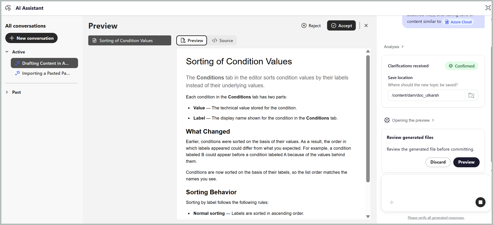

# Erstellen des ersten Entwurfs Ihres Inhalts

Die **Erstellen**-Kenntnisse im Agenten-Modus des KI-Assistenten helfen Ihnen beim Generieren des ersten Entwurfs strukturierter Inhalte aus Notizen, Spezifikationen, Whiteboard-Bildern, Screenshots oder anderen verfügbaren Referenzmaterialien. Die Kenntnis identifiziert automatisch den entsprechenden DITA-Thementyp, z. B. Konzept, Aufgabe, Referenz oder Fehlerbehebung, basierend auf den in Ihrem Repository verfügbaren Inhalten und Themenvorlagen, wodurch der manuelle Aufwand für die Strukturierung und Erstellung von Inhalten reduziert wird.

Sie können eine Datei anhängen, eine vorhandene Datei als Referenz für Ton und Stil auswählen und den Ordner angeben, in dem Sie die generierten Inhalte speichern möchten. Gehen Sie wie folgt vor, um einen ersten Entwurf Ihres gewünschten Inhalts zu erstellen:

1. Melden Sie sich bei Experience Manager Guides an.
1. Wählen Sie auf der Startseite in **Navigationsleiste die Option** KI-Assistent“ aus. Stellen Sie sicher[&#x200B; dass der KI-Assistent &#x200B;](../install-conf-guide/workspace-settings.md) Agentenmodus von Ihrem Administrator aktiviert wurde.

1. Wählen **im Bedienfeld**-Assistent die Option „Erstellen“ aus.

   Die Eingabeaufforderung für den Start wird im Eingabeaufforderungsfeld angezeigt: *Erstellen von Entwurfsinhalten, die auf angehängte Datei(en) verweisen und einen ähnlichen Inhaltston wie &quot;[&quot;]*

1. Fügen Sie Ihre Notizen, Spezifikationen oder andere Referenzdateien mit einer der folgenden Methoden an die Eingabeaufforderung an:

   - **Verknüpfung verwenden**: Geben Sie `/` in das Eingabeaufforderungsfeld ein und wählen Sie dann **Repository-Verweis hinzufügen** aus, um die Datei aus dem Repository auszuwählen (oder **Dateien vom Gerät hinzufügen**, um die Datei von Ihrem Computer hochzuladen).

   - **Verwenden des Symbols „Dateien anhängen“ oder „Kontext hinzufügen“ (+)**: Fügt Dateien von Ihrem lokalen System hinzu.

   - **Drag-and-Drop**: Ziehen Sie die Datei, die Sie aus dem System entwerfen möchten, per Drag-and-Drop direkt in die Eingabeaufforderung.

1. *(Optional)* Wählen Sie in der Starteraufforderung `[file]` aus. Wählen Sie das vorhandene Thema aus, dessen Ton der Entwurf entsprechen soll. Sie können das Thema aus dem Repository oder aus einer Sammlung auswählen. Der Themenname ersetzt `[file]` in der Eingabeaufforderung.

   {width="350"}

1. Wählen Sie **Senden** aus.

   Der KI-Assistent analysiert den Inhalt und listet jeden abgeschlossenen Schritt auf.

1. Beantworten Sie alle Folgefragen vom KI-Assistenten, um die Details bereitzustellen, die zum Generieren des Inhalts erforderlich sind.

   {width="350"}

1. Wählen Sie **Vorschau** aus, um das generierte Thema zu überprüfen.

   Überprüfen Sie jeden Entwurf anhand Ihres Quellmaterials und der von Ihnen gewünschten Themenarten.

   

1. Wählen Sie eine der folgenden Optionen aus:

   - **Akzeptieren**, um das Thema in dem bestätigten Ordner zu speichern
   - **Ablehnen**, um die Änderungen zu verwerfen, ohne zu speichern. Sie können einen Grund für die Ablehnung des Entwurfsinhalts angeben und eine Eingabeaufforderung mit den gewünschten Änderungen eingeben. Der KI-Assistent verwendet Ihr Feedback, um den Entwurfsinhalt zu überarbeiten.

     Das Thema ist jetzt in Ihrem Repository verfügbar.

     

Nachdem der KI-Assistent ein Thema erstellt hat, können Sie es im Editor öffnen und den Inhalt mithilfe von Folgeaufforderungen verfeinern. Auf diese Weise können Sie das Thema iterativ verbessern, ohne eine neue Konversation zu beginnen. Jede vorgeschlagene Änderung wird in der Vorschau mit **Änderungen nachverfolgen** angezeigt, sodass Sie die Änderungen vor der Anwendung überprüfen können.

So verfeinern Sie beispielsweise den Titel eines generierten Themas:

1. Öffnen Sie das neu erstellte Thema im Editor im Dialogfeld KI-Assistent .

   

1. Geben Sie im Bedienfeld KI-Assistent eine Folgenachricht ein, z. B. `Improve the title of this topic to make it generic.`

   

1. Wählen Sie **Senden** aus.

   KI-Assistent analysiert und schlägt einen neuen Titel vor.

1. Wählen Sie **Vorschau** aus, um die vorgeschlagenen Änderungen zu überprüfen.

   Die Vorschau zeigt den überarbeiteten Titel mit verfolgten Änderungen an und hebt hervor, was geändert wurde.

   

1. Klicken Sie **Akzeptieren**, um die Änderungen auf das Thema anzuwenden.

   

Sie können andere Elemente des Themas, wie Absätze, Schritte oder Tabellen, weiter verfeinern, indem Sie im selben Gespräch zusätzliche Eingabeaufforderungen bereitstellen.

