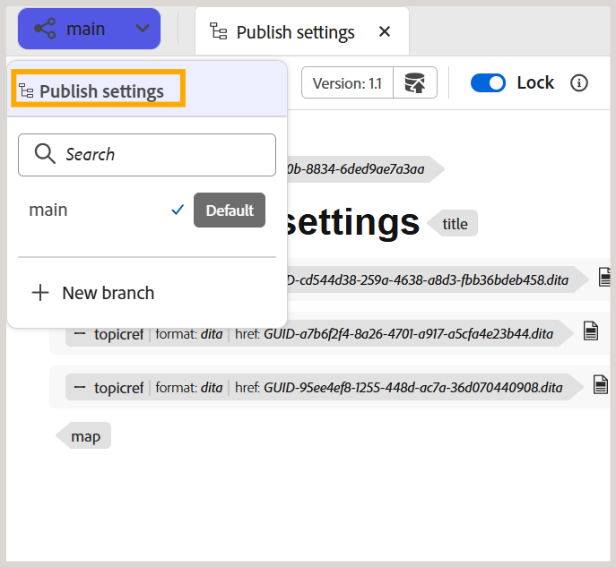

# Erstellen und Verwalten von Verzweigungen einer DITA-Zuordnung

In Experience Manager Guides können Sie mehrere Verzweigungen einer DITA-Zuordnung erstellen, um Dokumentationen für verschiedene Versionen, Funktionen oder Fehlerbehebungen zu verwalten. Sie können zwischen Verzweigungen wechseln, um mit den zugehörigen Inhalten zu arbeiten, nicht mehr benötigte Verzweigungen archivieren und sie bei Bedarf wiederherstellen.

Sie können auch eine Verzweigung aus jeder vorhandenen Verzweigung derselben DITA-Zuordnung erstellen.

## Erstellen einer Verzweigung

Sie können eine Verzweigung einer DITA-Map erstellen, um Dokumentationsänderungen zu bearbeiten, ohne den entsprechenden Inhalt in anderen Verzweigungen zu beeinflussen.

Führen Sie die folgenden Schritte aus, um eine Verzweigung zu erstellen:

1. Öffnen Sie die DITA-Karte, für die Sie eine Verzweigung erstellen möchten.

   >[!NOTE]
   >
   > Wenn bereits eine andere Zuordnung im Editor geöffnet ist, wird ein Bestätigungsdialogfeld angezeigt. Wählen Sie **Öffnen** aus, um die ausgewählte Zuordnung in der aktuellen Verzweigung zu öffnen. Weitere Informationen finden Sie unter [Inhalt außerhalb des aktuellen Zuordnungskontexts öffnen](#open-content-outside-the-current-map-context).

1. Wählen Sie das **Haupt** Verzweigung-Dropdown-Menü aus und überprüfen Sie, ob die erforderliche DITA-Zuordnung ausgewählt ist.

   

1. Wählen Sie **Neue Verzweigung** aus, um eine Verzweigung der ausgewählten Zuordnung zu erstellen.

1. Geben **im Dialogfeld &quot;** Verzweigung“ einen Namen für die neue Verzweigung ein und wählen Sie die übergeordnete Verzweigung aus, aus der Sie sie erstellen möchten.

   

1. Wählen Sie **Erstellen** aus.

Für die ausgewählte DITA-Zuordnung wird eine neue Verzweigung erstellt. Sie können jetzt zur neuen Verzweigung wechseln und mit der Bearbeitung der zugehörigen Inhalte beginnen.

## Wechseln zwischen den Verzweigungen

Führen Sie die folgenden Schritte aus, um Verzweigungen zu wechseln:

1. Wählen Sie **Dropdown-Menü** Verzweigung“ oben im Editor aus (der standardmäßig `main` angezeigt wird). Die Liste der verfügbaren Verzweigungen für die ausgewählte DITA-Zuordnung wird angezeigt.
1. Wählen Sie die Verzweigung aus, mit der Sie arbeiten möchten.

   

   Die ausgewählte Verzweigung wird geöffnet. Ihr Name wird in der Dropdown-Liste „Verzweigung“ oben im Editor angezeigt und ersetzt **main**.

   

Sie können jetzt in der ausgewählten Verzweigung mit der Zuordnung und den zugehörigen Inhalten arbeiten.

>[!NOTE]
>
>Wenn ein Thema beim Wechseln von Verzweigungen nicht gespeicherte Änderungen enthält, werden Sie in einem Dialogfeld aufgefordert, die Änderungen zu speichern, bevor Sie zur ausgewählten Verzweigung wechseln.

Sie können jetzt in der ausgewählten Verzweigung mit der Zuordnung und den zugehörigen Inhalten arbeiten.

## Isolierte Bearbeitung in einer Verzweigung

Wenn Sie in einer Verzweigung einer DITA-Map arbeiten, bleiben Änderungen am Inhalt in der ausgewählten Verzweigung und wirken sich nicht auf den entsprechenden Inhalt in anderen Verzweigungen aus. Dadurch können mehrere Autoren unabhängig über verschiedene Verzweigungen einer Zuordnung hinweg an denselben Themen arbeiten.

Standardmäßig werden unveränderte Themen aus dem Quellzweig oder der `main` gelesen. Wenn Sie ein Thema in der ausgewählten Verzweigung bearbeiten, wird es Teil dieser Verzweigung. Alle nachfolgenden Änderungen am Thema verbleiben innerhalb der ausgewählten Verzweigung.

Sie können zwischen Verzweigungen derselben DITA-Map wechseln, um die entsprechenden Inhalte anzuzeigen und zu bearbeiten.

### Bearbeiten von Themen innerhalb einer Verzweigung

Sie können Themen bearbeiten, die mit einer DITA-Zuordnung in der ausgewählten Verzweigung verknüpft sind, ohne deren Inhalt in anderen Verzweigungen zu beeinflussen.

Führen Sie die folgenden Schritte aus, um ein Thema zu bearbeiten:

1. Öffnen Sie die DITA-Karte im Editor.
2. Wählen Sie aus der Dropdown-Liste Verzweigung die Verzweigung aus, in der Sie das Thema bearbeiten möchten.
3. Öffnen Sie das Thema, das Sie in der Zuordnung ändern möchten.
4. Nehmen Sie die erforderlichen Änderungen am Thema vor.
5. Speichern Sie Ihre Änderungen.

   Eine Kopie des geänderten Themas wird im ausgewählten Zweig gespeichert. Das entsprechende Thema in anderen Verzweigungen bleibt unverändert.

Sie können mit der Bearbeitung des Themas in der ausgewählten Verzweigung fortfahren oder zu einer anderen Verzweigung wechseln, um den Inhalt zu bearbeiten.

### Eine Karte außerhalb des aktuellen Zuordnungskontexts öffnen

In Experience Manager Guides bezieht **map context** sich auf die DITA-Karte, die derzeit im Editor geöffnet ist.

Wenn Sie versuchen, eine Zuordnung, ein Thema oder ein Asset zu öffnen, die bzw. das nicht Teil des aktuellen Zuordnungskontexts ist, wird ein Bestätigungsdialogfeld mit den folgenden Optionen angezeigt:

- **Öffnen** Ersetzt den aktuellen Zuordnungskontext durch den ausgewählten Inhalt.
- **Im Editor öffnen** Öffnet den Inhalt auf einer neuen Registerkarte, ohne den aktuellen Zuordnungskontext zu ändern.
- **Abbrechen:** Bricht den Vorgang ab und behält den aktuellen Zuordnungskontext bei.

Angenommen, `master_map.ditamap` ist derzeit in der Verzweigung **main** ausgewählt.

Wenn Sie versuchen, eine andere DITA-Map zu öffnen, wird das folgende Bestätigungsdialogfeld angezeigt:

Wählen Sie **Öffnen** aus, um zur ausgewählten Zuordnung zu wechseln.

Der Zuordnungskontext der `main` Verzweigung wird auf die neu ausgewählte Zuordnung aktualisiert, sodass Sie mit den zugehörigen Inhalten arbeiten können.

### Themen außerhalb des aktuellen Zuordnungskontexts öffnen oder bearbeiten

Themen, die nicht von der Zuordnung referenziert werden, sind in der Verzweigung nicht automatisch verfügbar.

Wählen Sie **Bearbeiten im aktuellen Zweig**, um diese Themen in der ausgewählten Verzweigung zur Bearbeitung verfügbar zu machen.

Sie können das Thema jetzt bearbeiten, ohne den Inhalt in `main` zu beeinflussen. Das Thema wird jedoch nicht automatisch zur zugehörigen DITA-Zuordnung hinzugefügt und ist nicht in der veröffentlichten Ausgabe enthalten. Um das Thema in die Ausgabe aufzunehmen, fügen Sie es zur DITA-Zuordnung hinzu.

## Verzweigungen verwalten

Sie können Verzweigungen einer DITA-Zuordnung über das Bedienfeld **Verzweigungen** in der Zuordnungskonsole verwalten. Sie können verfügbare Verzweigungen anzeigen, neue Verzweigungen erstellen, bestehende Verzweigungen zusammenführen oder umbenennen und nicht mehr aktiv verwendete Verzweigungen archivieren.

Das Bedienfeld **Verzweigungen** listet alle verfügbaren Verzweigungen für die ausgewählte DITA-Zuordnung auf.

Um eine Verzweigung zu verwalten, bewegen Sie den Mauszeiger über die gewünschte Verzweigung und wählen Sie das Menü **Optionen** aus. Die folgenden Aktionen sind verfügbar:

- **Neue Verzweigung:** Erstellen Sie eine neue Verzweigung aus der ausgewählten Verzweigung.
- **Zusammenführen in Hauptverzweigung** [Änderungen zusammenführen](./merge-branches.md) vom ausgewählten Zweig in den `main` Zweig.
- **Verzweigung umbenennen:** Ändern Sie den Namen der ausgewählten Verzweigung.
- **Zusammenführungsverlauf:** Zeigt den Verlauf der Zusammenführungsaktivitäten an. Diese Option ist erst verfügbar, nachdem eine Zusammenführungsanfrage erstellt wurde.
- **Verzweigung archivieren** Eine Verzweigung archivieren, die nicht mehr aktiv verwendet wird.

  >[!NOTE]
  >
  > Experience Manager Guides unterstützt nicht das Löschen von Verzweigungen. Sie können Verzweigungen archivieren, die nicht mehr aktiv verwendet werden.

Sie können auch die Optionen oben im Bedienfeld **Verzweigungen** verwenden, um nach einer Verzweigung zu suchen, die Verzweigungsliste zu aktualisieren oder eine neue Verzweigung zu erstellen.

### Archivieren einer Verzweigung

Sie können nicht mehr aktiv verwendete Verzweigungen einer DITA-Map archivieren und bei Bedarf wiederherstellen.

>[!NOTE]
>
> Die Standardverzweigung (`main`) kann nicht archiviert werden.

Um eine Verzweigung zu archivieren, führen Sie die folgenden Schritte aus:

1. Wählen Sie im **Verzweigungen** das Symbol **Verwalten** aus.

   

   Das **Verzweigungen verwalten** wird angezeigt.

   

   Das Dialogfeld enthält die folgenden Registerkarten:

   - **Aktiv:** Listet alle aktiven Verzweigungen der ausgewählten DITA-Zuordnung auf.
   - **Archiviert:** Listet alle archivierten Verzweigungen der ausgewählten DITA-Zuordnung auf.

2. Bewegen Sie **der Registerkarte Aktiv** den Mauszeiger über die Verzweigung, die Sie archivieren möchten, und wählen Sie **Archivieren** aus.

   

   Die ausgewählte Verzweigung wird archiviert und auf die Registerkarte **Archiviert** verschoben.

### Wiederherstellen einer archivierten Verzweigung

Sie können einen archivierten Zweig einer DITA-Map wiederherstellen, wenn Sie die Arbeit am Inhalt fortsetzen müssen.

Um eine archivierte Verzweigung wiederherzustellen, führen Sie die folgenden Schritte aus:

1. Wählen Sie im **Verzweigungen** das Symbol **Verwalten** aus.
2. Wählen **Dialogfeld „Verzweigungen verwalten** die Registerkarte **Archiviert** aus.
3. Suchen Sie die Verzweigung, die Sie wiederherstellen möchten, und wählen Sie **Wiederherstellen**.

   Die Verzweigung wird wiederhergestellt und auf der Registerkarte **Aktiv** angezeigt.

