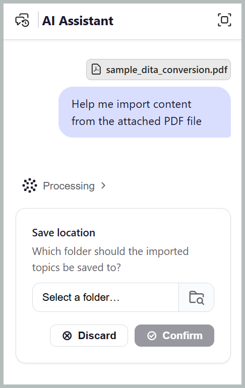
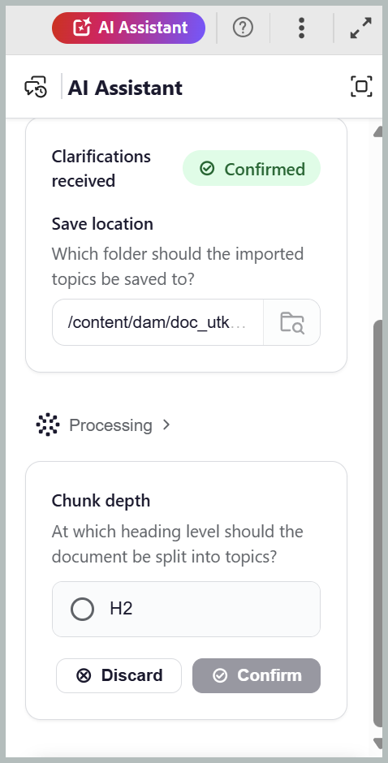

# Importieren von Inhalten mit dem KI-Assistenten

Die **Import**-Kenntnisse im Agent-Modus des KI-Assistenten helfen Ihnen, vorhandene PDF-, Word- oder Markdown-Dateien in strukturierte DITA-Themen zu konvertieren, mit der Option, DITA-Zuordnungen basierend auf der Benutzereingabe zu generieren. Es vereinfacht die Aufnahme von Inhalten von unstrukturierten in strukturierte Formate in Adobe Experience Manager Guides, indem es den manuellen Aufwand für die Neuerstellung, Strukturierung und Organisation von Inhalten reduziert.

## Importieren einer Datei

Sie können Dateien von Ihrem Gerät oder Inhalts-Repository importieren, die Überschriftenebene angeben, die den Beginn eines neuen Themas definiert, und den Zielordner für den importierten Inhalt auswählen. Gehen Sie wie folgt vor, um eine Datei zu importieren:

1. Melden Sie sich bei Experience Manager Guides an.
1. Wählen Sie auf der Startseite in **Navigationsleiste die Option** KI-Assistent“ aus. Stellen Sie sicher[ dass der KI-Assistent ](../install-conf-guide/workspace-settings.md) Agentenmodus von Ihrem Administrator aktiviert wurde.
1. Wählen **Importieren** im Bedienfeld „KI-Assistent“ aus. Sie können auch andere Eingabeaufforderungen wie &quot;*in DITA-Themen konvertieren* für eine Word-Datei oder *Markdown in DITA-Themen konvertieren* für eine Markdown-Datei verwenden.

   Im Eingabeaufforderungsfeld wird die *„Hilfe zum Importieren von Inhalten aus der angehängten PDF* Datei“ angezeigt.

1. Hängen Sie die Datei mit einer der folgenden Methoden an die Eingabeaufforderung an:

   - **Verknüpfung verwenden**: Geben Sie `/` in das Eingabeaufforderungsfeld ein und wählen Sie dann **Repository-Verweis hinzufügen** aus, um die Datei aus dem Repository auszuwählen (oder **Dateien vom Gerät hinzufügen**, um die Datei von Ihrem Computer hochzuladen).

   - **Verwenden des Symbols „Dateien anhängen“ oder „Kontext hinzufügen“ (+)**: Fügen Sie Dateien aus Ihrem lokalen System hinzu, um den Inhalt für den Import bereitzustellen.

   - **Drag-and-Drop**: Ziehen Sie die Datei, die Sie aus dem System importieren möchten, per Drag-and-Drop direkt in die Eingabeaufforderung.

     

1. Wählen Sie **Senden** aus.

   Der KI-Assistent analysiert die Datei und listet jeden abgeschlossenen Schritt auf.

1. Wählen Sie den Ordner aus, in dem Sie die importierten Themen speichern möchten, und bestätigen Sie ihn.

   

1. Wählen Sie die Überschriftenebene aus, die zu einem Thema wird. Beispiel: H2, wie im Screenshot gezeigt.

   Beantworten Sie alle zusätzlichen Folgefragen, die die erforderlichen Details für den Importprozess zu enthalten scheinen.

   

1. Wählen Sie **Bestätigen** aus.

   Der KI-Assistent konvertiert die Datei. Die Importfertigkeit identifiziert und weist automatisch geeignete DITA-Thementypen wie Aufgabe, Fehlerbehebung und mehr basierend auf den importierten Inhalten zu.

1. Wählen Sie **Vorschau** aus, um die generierten Themen und die Zuordnung anzuzeigen.

   Vergewissern Sie sich, dass jedes Thema mit der erwarteten Überschrift beginnt und dass die Zuordnungsreihenfolge mit der Originaldatei übereinstimmt. Sie können auch den Source-Code der importierten Daten über die Registerkarte Source überprüfen.

   

1. Wählen Sie eine der folgenden Optionen aus:

   - **Akzeptieren**, um alle Themen zu speichern und dem bestätigten Ordner zuzuordnen.
   - **Ablehnen**, um den Import zu verwerfen, ohne zu speichern. Sie können einen Grund für die Ablehnung des Imports angeben und eine Eingabeaufforderung mit den gewünschten Änderungen eingeben. Der KI-Assistent nutzt Ihr Feedback, um den Import zu überarbeiten.

   Die Themen und die Zuordnung sind jetzt in Ihrem Repository verfügbar.

   

Nach Abschluss der Konvertierung öffnet der KI-Assistent eine Vorschau der generierten Themen und Zuordnungen. Sie können direkt im Dialogfeld KI-Assistent zur entsprechenden Karte und zu den entsprechenden Themen navigieren.

## Importieren von eingefügten Inhalten als Themen

Durch das Einfügen von Inhalten aus einer Web-Seite, Word, Google Docs oder einem Wiki können Sie importieren, ohne zuvor eine Datei zu speichern. Formatierte Inhalte behalten ihre Überschriften, Listen und Tabellen bei.

So importieren Sie eingefügte Inhalte:

1. Melden Sie sich bei Experience Manager Guides an.
1. Wählen Sie auf der Startseite in **Navigationsleiste die Option** KI-Assistent“ aus. Stellen Sie sicher, dass der KI-Assistent im Agentenmodus von Ihrem Administrator aktiviert wurde.
1. Kopieren Sie den Inhalt von der Web-Seite, von Word, Google Docs oder Wiki.
1. Fügen Sie den Inhalt in das Eingabeaufforderungsfeld ein.

   Formatierter Inhalt mit mehr als 2.000 Zeichen wird als Markdown angehängt, sodass seine Struktur übernommen wird.

   

1. Geben Sie eine Eingabeaufforderung ein, die den gewünschten Inhalt angibt.

   Geben Sie beispielsweise *Importieren der eingefügten Seite in DITA* oder *Ändern des eingefügten Inhalts in DITA-Themen und eine Zuordnung*

1. Wählen Sie **Senden** aus.

Der KI-Assistent fordert Sie auf, die Überschriftenebene für die Aufteilung von Inhalten in Themen auszuwählen und den Zielordner anzugeben. Die restlichen Schritte sind dieselben wie das Importieren einer angehängten Datei, einschließlich der Überprüfung und Bestätigung des Import-Workflows zum Generieren von DITA-Themen und einer Zuordnung.

