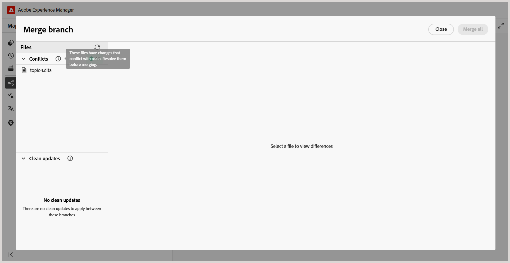

# Zusammenführen einer Verzweigung mit einer Hauptverzweigung

In Experience Manager Guides können Sie Änderungen aus einer Verzweigung einer DITA-Zuordnung mit der `main` Verzweigung zusammenführen. Durch die Zusammenführung können Sie abgeschlossene Dokumentationsaktualisierungen in `main` integrieren, ohne die Änderungen manuell in `main` zu kopieren.

Nehmen wir als Beispiel eine DITA-Zuordnung namens `install-the-lift.ditamap` mit einer Verzweigung namens `Release 2`. Autoren können die Installationsanweisungen in dieser Verzweigung aktualisieren, während die vorhandene Dokumentation in `main` unverändert bleibt.

Sobald die Aktualisierungen fertig sind, können Autoren die Änderungen aus `Release 2` in `main` zusammenführen.

## Verstehen der Verzweigungszusammenführung

Beim Zusammenführen werden Änderungen aus einem ausgewählten Zweig einer DITA-Zuordnung in den `main` Zweig übernommen.

- **Source-Verzweigung:** Die Verzweigung, die die Änderungen enthält, die Sie zusammenführen möchten.
- **Target-Verzweigung:** Die Standardverzweigung (`main`), in der die Änderungen zusammengeführt werden.

Wenn derselbe Teil eines Themas/einer Zuordnung in beiden Verzweigungen geändert wurde, können Zusammenführungskonflikte auftreten, die eine Lösung erfordern.

## Zusammenführen einer Verzweigung

Sie können Änderungen aus einem ausgewählten Zweig einer DITA-Zuordnung in `main` zusammenführen.

Um eine Verzweigung zusammenzuführen, führen Sie die folgenden Schritte aus:

1. Öffnen Sie die erforderliche DITA-Zuordnung in der Zuordnungskonsole.
2. Navigieren Sie zur Registerkarte **Verzweigungen**.
3. Suchen Sie die Verzweigung, die die Änderungen enthält, die Sie zusammenführen möchten.
4. Öffnen Sie das Menü **Optionen** der Verzweigung und wählen Sie **In Haupt zusammenführen**.

   

   Für die ausgewählte Verzweigung wird eine Zusammenführungsanfrage erstellt. Auf diese Weise können Sie die Änderungen überprüfen und Konflikte lösen, bevor Sie sie in `main` zusammenführen.

   

5. Wählen Sie die Zusammenführungsanfrage aus.

   Die Zusammenführungsanfrage wird in der Ansicht **Zweig zusammenführen** geöffnet. Überprüfen Sie die Änderungen und lösen Sie ggf. Konflikte.
6. Schließen Sie die Zusammenführung ab.

   Überprüfen Sie die Änderungen und lösen Sie ggf. Konflikte. Weitere Informationen finden Sie unter [Zusammenführungskonflikte lösen](#resolve-merge-conflicts).

   Nachdem alle Konflikte gelöst wurden, wählen Sie **Alle zusammenführen** aus, um die Änderungen in `main` zusammenzuführen.

   Die Änderungen werden in der `main` zusammengeführt.

## Auflösen von Zusammenführungskonflikten

Ein Zusammenführungskonflikt tritt auf, wenn derselbe Inhalt sowohl in der `main` als auch in der zusammengeführten Verzweigung geändert wurde. Sie müssen alle Konflikte lösen, bevor Sie die Änderungen in `main` zusammenführen.

Wenn Sie eine Zusammenführungsanfrage öffnen, werden die folgenden Abschnitte in der Ansicht **Zweig zusammenführen** angezeigt:

- **Konflikte:** Listet Dateien auf, die eine Konfliktbehebung erfordern.
- **Aktualisierungen bereinigen:** Listet Dateien auf, die zusammengeführt werden können, ohne Konflikte zu lösen.

Bei Dateien mit Konflikten wird die Ansicht **Verzweigung zusammenführen** angezeigt.

Die **Verzweigung zusammenführen** enthält die folgenden Bereiche:

- **Linker Bereich (Haupt):** Zeigt den Inhalt der Standardverzweigung (`main`) an.
- **Mittlerer Bereich (Zusammengeführt):** Zeigt den zusammengeführten Inhalt an, in dem Sie Änderungen von einer der Verzweigungen annehmen oder den Inhalt direkt bearbeiten können.
- **Rechter Bereich (ausgewählter Zweig):** Zeigt den Inhalt des Zweigs an, der mit `main` zusammengeführt wird.

Die Unterschiede werden im linken und rechten Bereich basierend auf dem Inhalt im Bereich **Zusammengeführt** hervorgehoben:

- **Rot (-):** Gibt den Inhalt im Bereich **Zusammengeführt** an, der sich vom Inhalt im entsprechenden linken oder rechten Bereich unterscheidet.
- **Grün (+):** Gibt den Inhalt im linken oder rechten Bereich an, der nicht im Bereich **Zusammengeführt“**.

Zunächst enthält der Bereich **Zusammengeführt** denselben Inhalt wie `main`, sodass die Unterschiede im rechten Bereich hervorgehoben werden. Sobald Sie Änderungen von der ausgewählten Verzweigung akzeptieren, zeigt der linke Bereich Unterschiede zum aktualisierten Bereich **Zusammengeführt** an.

Führen Sie die folgenden Schritte aus, um Zusammenführungskonflikte zu lösen:

1. Wählen Sie **Abschnitt** die Datei mit den Konflikten aus.

   >[!NOTE]
   >
   > Die unter **Aktualisierungen bereinigen** aufgelisteten Dateien enthalten Änderungen, die nur in der ausgewählten Verzweigung vorgenommen wurden, und erfordern daher keine Konfliktbehebung.

2. Überprüfen Sie die in der Ansicht **Zusammenführungszweig** hervorgehobenen Unterschiede und lösen Sie die Konflikte mithilfe der Zusammenführungssteuerelemente.

   Das Kontrollkästchen neben einem Konflikt im rechten Bereich bestimmt, wie der ausgewählte Inhalt der Verzweigung zum Bereich **Zusammengeführt** hinzugefügt wird:

   - **Ausgewählt (Standard):** Ersetzt den entsprechenden Inhalt im Bereich **Zusammengeführt** durch den ausgewählten Inhalt der Verzweigung.
   - **Gelöscht:** Fügt den ausgewählten Verzweigungsinhalt zusammen mit dem vorhandenen Inhalt im Bereich **Zusammengeführt** hinzu, ohne ihn zu ersetzen.

   Sie können Konflikte mit den folgenden Optionen auflösen:

   - Wenn Sie die Änderungen aus dem ausgewählten Zweig verwenden möchten, lassen Sie das Kontrollkästchen für den Konflikt aktiviert und wählen Sie dann die entsprechende Nach-links-Pfeilsteuerung (`<<<`) aus. Der ausgewählte Inhalt der Verzweigung ersetzt den widersprüchlichen Inhalt im Bereich **Zusammengeführt**.

     

   - Wenn Sie Inhalte aus beiden Verzweigungen beibehalten möchten, deaktivieren Sie das Kontrollkästchen für den Konflikt und wählen Sie dann die Nach-links-Pfeilsteuerung (`<<<`) aus. Dadurch wird der ausgewählte Inhalt der Verzweigung zum Bereich **Zusammengeführt** hinzugefügt, ohne den bereits in diesem Bereich vorhandenen Inhalt zu ersetzen.

     

   - Wenn Sie Änderungen vom ausgewählten Zweig akzeptiert haben und den entsprechenden Inhalt von `main` wiederherstellen möchten, wählen Sie im linken Bereich das Steuerelement (`>>>`) mit dem Pfeil nach rechts. Dadurch wird der ausgewählte Inhalt im Bereich **Zusammengeführt** durch die Version aus `main` ersetzt.

   >[!TIP]
   >
   > Bewegen Sie den Mauszeiger über ein Pfeilsteuerelement, um zu sehen, wie sich das Akzeptieren der ausgewählten Änderung auf den Bereich **Zusammengeführt** auswirkt.

3. Nach der Überprüfung des zusammengeführten Inhalts können Sie auch eine der folgenden Optionen verwenden, um den gesamten Inhalt aus beiden Verzweigungen zu akzeptieren:

   - **Hauptversion akzeptieren:** Ersetzt den Inhalt im Bereich **Zusammengeführt** für die ausgewählte Datei durch die Version aus `main`.
   - **Akzeptieren [Verzweigungsname]:** Ersetzt den Inhalt im Bereich **Zusammengeführt** für die ausgewählte Datei durch die Version aus der ausgewählten Verzweigung.

   >[!NOTE]
   >
   > Wenn Sie eine der Optionen auswählen, wird der gesamte Inhalt im Bereich **Zusammengeführt** für die ausgewählte Datei ersetzt, einschließlich aller Änderungen, die Sie beim Lösen von Konflikten manuell vorgenommen haben.

   Alternativ können Sie den Inhalt direkt im Bereich „Zusammengeführt **überprüfen oder bearbeiten** dann **Aufgelöst markieren** um den zusammengeführten Inhalt beizubehalten.

4. Überprüfen Sie den endgültigen Inhalt im Bereich **Zusammengeführt** und wählen Sie **Aufgelöst markieren** aus, um die Datei als aufgelöst zu markieren.

5. Wiederholen Sie die Schritte für alle Dateien, die unter **Konflikte** aufgeführt sind.

   Sobald alle Konflikte gelöst sind, wird **Option „Alle** zusammenführen“ verfügbar.

6. Wählen Sie **Alle zusammenführen** aus, um die aufgelösten Dateien und die bereinigten Aktualisierungen in `main` zusammenzuführen.

   >[!NOTE]
   > 
   > Die Option **Alle zusammenführen** bleibt deaktiviert, bis alle Konflikte behoben sind.

   Die aufgelösten Änderungen werden in `main` zusammengeführt. Eine abgeschlossene Zusammenführung kann nicht rückgängig gemacht werden. Sie können jedoch eine neue Zusammenführungsanfrage erstellen, um nachfolgende Änderungen mit Hauptänderungen zusammenzuführen.

## Verwalten einer Zusammenführungsanfrage

Sie können vorhandene Zusammenführungsanfragen über das Kontextmenü verwalten.

Um eine Zusammenführungsanfrage zu verwalten, öffnen Sie das zugehörige Kontextmenü und wählen Sie eine der folgenden Optionen aus:

- **Vorschau** Zeigt die Änderungen in der Zusammenführungsanfrage an, ohne sie zusammenzuführen.
- **Protokoll anzeigen** Protokoll anzeigen, das mit der Zusammenführungsanfrage verknüpft ist.
- **Löschen** Löschen Sie die Zusammenführungsanfrage. Die Verzweigung und ihre Änderungen sind davon nicht betroffen.
- **Bericht anzeigen** Zeigt den Zusammenführungsbericht an, nachdem die Verzweigung mit `main` zusammengeführt wurde.