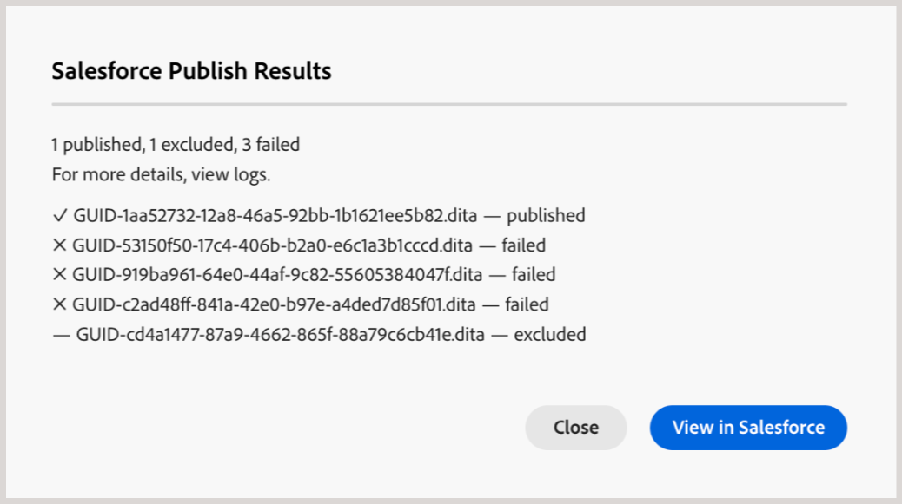

# Generieren einer Wissensdatenbankausgabe {#id218CL05J0M1}

Adobe Experience Manager Guides verfügt über eine Funktion zur artikelbasierten Veröffentlichung, mit der Benutzer einen oder mehrere Knowledge Base-Artikel gleichzeitig veröffentlichen können.

Diese Engine enthält auch eine OOTB-Inhaltsvorlage, die auf den Adobe Experience Manager-Kernkomponenten basiert und es Benutzern ermöglicht, ein wissensbasiertes Repository für die technischen Inhalte zu erstellen. Diese Vorlage kann an die Bedürfnisse der Kundinnen und Kunden angepasst werden.Diese Engine ermöglicht es den Benutzenden, die DITA-Karte additiv zu erstellen und Themen zu veröffentlichen, sobald sie bereit sind.

Wenn Sie den Inhalt nur für einige Themen in Ihrer DITA-Karte aktualisiert haben, müssen Sie nicht immer die gesamte Karte veröffentlichen. Sie können nur die aktualisierten Themen auswählen und veröffentlichen.

Für die artikelbasierte Veröffentlichung müssen Sie die Ausgabevorgabe für Ihre Wissensdatenbank-DITA-Zuordnung erstellen. Ihre Karte muss die Themen enthalten, die Sie veröffentlichen möchten. Sie können auch Bedingungen anwenden und die AEM Sites-Details für die Ausgabevorgabe angeben. Anschließend können Sie mit der Funktion „Ausgabe generieren **eine Ausgabe**.

Führen Sie die folgenden Schritte aus, um eine artikelbasierte Ausgabe zu generieren:

1. [Erstellen der Knowledgebase-Voreinstellung](./generate-output-knowledge-base.md) für die artikelbasierte Ausgabe.
1. Navigieren Sie zur Registerkarte **Artikel** und wählen Sie die Themen aus, für die Sie die Ausgabe generieren möchten.

   

   >[!NOTE]
   >
   > Beim Veröffentlichen in Salesforce wird neben der Registerkarte **Artikel** ein Warnsymbol angezeigt, wenn keine Themen für die Veröffentlichung ausgewählt wurden. Das Warnsymbol wird ausgeblendet, sobald Sie ein oder mehrere Themen auswählen.
1. Wählen Sie **oben** Ausgabe generieren“ aus, um die Ausgabe zu generieren.
1. Wählen Sie in **Eingabeaufforderung Dateien für** Veröffentlichung bestätigen die Dateien aus, die Sie veröffentlichen möchten, und bestätigen Sie Ihre Auswahl durch **Veröffentlichen**.

   

   Sie sehen den Status des Ausgabegenerierungsprozesses. Die Spalte **Themen** listet die Themen auf, für die Ausgaben generiert werden, während die Spalte **Status** den Veröffentlichungsstatus jedes Themas anzeigt.

   

   Um die Ausgabe anzuzeigen, schließen Sie das Dialogfeld **Ausgabe generiert** und wählen Sie **Ausgabe anzeigen** auf der Seite „Voreinstellung“ aus.

   >[!NOTE]
   >
   > Sie können eine vorhandene Ausgabevorgabe auch über das Menü Optionen umbenennen, duplizieren oder löschen.

## Verbesserte Salesforce-Veröffentlichung mithilfe der Backend-Verarbeitung

Ab Version 2026.11.0 von Experience Manager Guides as a Cloud Service ist ein verbessertes Salesforce-Veröffentlichungserlebnis verfügbar. Es verwendet die Backend-Verarbeitung, um größere Veröffentlichungsaufträge zu unterstützen, die Sicherheit zu verbessern und Probleme mit dem vorhandenen Veröffentlichungsprozess zu beheben.

>[!NOTE]
>
> Das erweiterte Salesforce-Veröffentlichungserlebnis ist standardmäßig deaktiviert. Wenden Sie sich zur Aktivierung an das Kundenerfolgs-Team von Adobe.

Wenn Sie Artikel in Salesforce mit dem erweiterten Erlebnis veröffentlichen, stehen die folgenden zusätzlichen Funktionen zur Verfügung:

- **Warnung bei nicht ausgewählten Themen**: Wenn keine Themen zur Veröffentlichung ausgewählt sind, wird auf der Registerkarte **Artikel** der Ausgabevorgabe der Salesforce Knowledge Base ein Warnhinweis angezeigt. Die Warnung verschwindet, sobald Sie ein oder mehrere Themen auswählen.

  
- **Veröffentlichungsstatus auf Artikelebene**: Nach der Ausgabegenerierung wird der Veröffentlichungsstatus jedes Artikels, z. B. „Erfolg“ oder „Fehlgeschlagen“, zusammen mit dem zugehörigen Thema oder Dateinamen im Dialogfeld **Saleforce-Veröffentlichungsergebnisse** angezeigt.

  

- **Veröffentlichungsprotokolle**: Verwenden Sie die Option **Protokoll anzeigen** in der Ausgabevorgabe der Salesforce Knowledge Base, um Veröffentlichungsprotokolle zu überprüfen und Fehler oder Warnungen zu beheben.

  

  Die Protokolle enthalten auch eine Zusammenfassung der Veröffentlichungsergebnisse.

  
- **Ausgabehistorie**: Anzeigen des Ausgabehistoriums von Veröffentlichungsaufgaben über die **Map-Konsole** oder die **Assets-**.

  Weitere Informationen zum Verwalten von Veröffentlichungsaufgaben finden Sie unter [Prozess der Ausgabenerstellung verwalten](./generate-output-manage-process.md).

  
- **Optimierte Asset-Veröffentlichung:** Beim Veröffentlichen von Themen in Salesforce prüft Experience Manager Guides, ob die referenzierten Assets, z. B. Multimedia- und andere Nicht-DITA-Dateien, seit ihrer letzten Veröffentlichung geändert wurden. Nur geänderte Assets werden erneut veröffentlicht, während unveränderte Assets übersprungen werden. Dadurch werden redundante Asset-Aktualisierungen reduziert und die Publishing-Effizienz verbessert.

### Token-basierte Authentifizierung einstellen und aktualisieren

Die verbesserte Salesforce-Veröffentlichungserfahrung unterstützt auch die Token-basierte Authentifizierung, sodass Sie sich nicht mehr wiederholt von Experience Manager Guides aus bei Salesforce anmelden müssen, wenn Zugriffstoken ablaufen.

>[!NOTE]
>
> Die Unterstützung von Aktualisierungstoken ist standardmäßig deaktiviert. Wenden Sie sich zur Aktivierung an das Kundenerfolgs-Team von Adobe.

Um diese Funktion zu verwenden, stellen Sie sicher, dass **Anfragen jederzeit ausführen (refresh_token, offline_access)** in den ausgewählten OAuth-Bereichen enthalten ist und **Proof Key for Code Exchange (PKCE)-Erweiterung für unterstützte Autorisierungsflüsse erforderlich** in Ihrer mit Salesforce verbundenen App aktiviert ist.

Durch Aktivierung der Unterstützung von Aktualisierungstoken in Experience Manager Guides wird die PKCE-Unterstützung automatisch aktiviert. Die entsprechende Einstellung muss jedoch auch in Salesforce aktiviert werden, damit die Authentifizierung erfolgreich funktioniert.

**Übergeordnetes Thema:**&#x200B;[&#x200B; Arbeiten mit dem Editor](web-editor.md)
